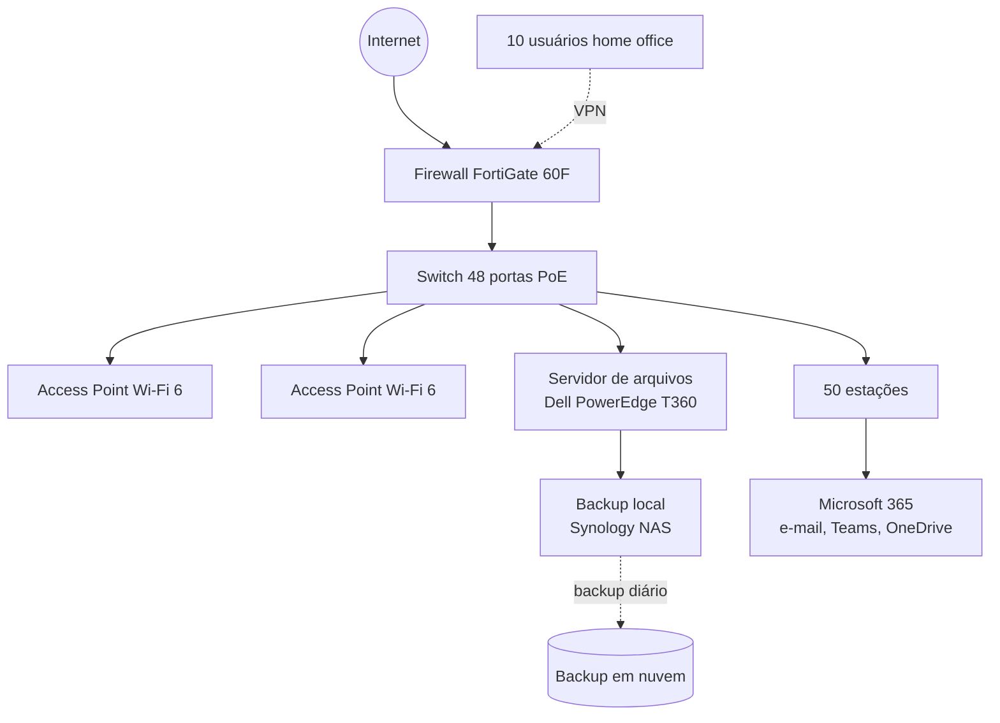

# Caso 01 — Escritório de contabilidade, 50 usuários

## 1. Cenário
Escritório de contabilidade em São Paulo, 50 colaboradores em um único andar, sem equipe de TI interna. Hoje usam e-mail gratuito, arquivos espalhados em pendrives e computadores pessoais, sem backup e sem controle de acesso. Precisam profissionalizar a infraestrutura antes de uma auditoria de clientes.

## 2. Requisitos levantados
**Funcionais**
- E-mail corporativo com domínio próprio para 50 usuários
- Servidor de arquivos central com controle de permissão por departamento
- Rede cabeada e Wi-Fi estáveis para 50 estações + visitantes
- Backup diário com cópia fora do escritório
- Acesso remoto seguro para 10 usuários em home office

**Restrições**
- Sem profissional de TI interno → solução precisa ser gerenciável por parceiro
- Orçamento inicial limitado → preferência por assinatura (OPEX) onde fizer sentido
- Dados fiscais de clientes → segurança e retenção são obrigatórias

## 3. Solução proposta
Infraestrutura híbrida: rede e servidor de arquivos local (latência e controle), e-mail e colaboração em nuvem (Microsoft 365), backup em nuvem e firewall de borda com VPN para o home office.

## 4. Bill of Materials (BOM)

| # | Item | Fabricante / Modelo | Qtd | Função na solução | Preço est. (R$) |
|---|---|---|---|---|---|
| 1 | Firewall UTM | Fortinet FortiGate 60F + licença UTP 1 ano | 1 | Segurança de borda, VPN SSL para home office, filtro web | 7.500 |
| 2 | Switch gerenciável PoE | Cisco CBS350-48P | 1 | Conecta estações, APs e servidor; PoE alimenta os APs | 9.000 |
| 3 | Access Point Wi-Fi 6 | Ubiquiti U6 Pro | 2 | Cobertura Wi-Fi do andar, rede separada para visitantes | 2.400 |
| 4 | Servidor de arquivos | Dell PowerEdge T360 (Xeon E, 32 GB, 2×4 TB RAID 1) | 1 | Arquivos centralizados, Active Directory, permissões por setor | 18.000 |
| 5 | Licença servidor | Windows Server 2022 Standard + 50 CALs | 1 | Sistema operacional e licenciamento de acesso dos usuários | 9.500 |
| 6 | Backup local | Synology DS923+ com 2×8 TB | 1 | Cópia diária do servidor, restauração rápida | 8.000 |
| 7 | Backup em nuvem | Serviço de backup (ex.: Backblaze B2 / AWS S3) — 4 TB | 12 meses | Cópia off-site, proteção contra ransomware e sinistro | 1.500 |
| 8 | E-mail e colaboração | Microsoft 365 Business Standard | 50 × 12 meses | E-mail com domínio próprio, Teams, OneDrive, Office | 45.000 |
| 9 | Nobreak | APC Smart-UPS 1500 VA | 2 | Proteção elétrica do rack (servidor, switch, firewall) | 5.000 |
| 10 | Rack e cabeamento | Rack 12U + patch panel + 60 pontos Cat6 | 1 | Organização física e rede cabeada para as estações | 12.000 |
| | **Total estimado (ano 1)** | | | | **~117.900** |

## 5. Justificativa das escolhas
- **FortiGate 60F** — porte certo para 50 usuários com folga; VPN SSL inclusa resolve o home office sem produto extra; é a linha mais comum no mercado de parceiros, o que facilita suporte gerenciado.
- **Switch PoE de 48 portas** — 50 estações + 2 APs + servidor + impressoras; PoE elimina fonte nos APs. Optei por 48 e não 24 para não precisar empilhar dois switches.
- **Servidor local em vez de 100% nuvem** — escritório contábil move arquivos grandes o dia todo; servidor local dá latência zero e controle de permissão via Active Directory. RAID 1 protege contra falha de disco.
- **Microsoft 365 Business Standard** — resolve e-mail, Teams e Office em uma assinatura; o plano *Basic* não inclui Office desktop, que contabilidade usa pesado (Excel).
- **Backup em duas camadas (NAS + nuvem)** — NAS restaura rápido; nuvem protege contra ransomware, incêndio e furto. Regra 3-2-1.
- **Dois nobreaks** — um para servidor/NAS, outro para rede, evitando ponto único de falha elétrica.

## 6. Alternativas consideradas e descartadas
| Alternativa | Por que foi descartada |
|---|---|
| 100% em nuvem (sem servidor local) | Arquivos grandes e uso intenso de Excel em rede tornariam a experiência lenta; migração mais complexa sem TI interna |
| Google Workspace em vez de Microsoft 365 | Escritório contábil depende de Excel avançado e integração com sistemas fiscais Windows |
| Firewall apenas no roteador do provedor | Sem VPN empresarial, sem filtro de conteúdo, sem visibilidade; inaceitável para dados fiscais |
| Backup só no NAS | Não protege contra ransomware ou sinistro físico |

## 7. Premissas e fontes
- Preços são estimativas de referência (out/2026) com base em catálogos públicos de distribuidores e fabricantes; variam com câmbio e negociação
- Mão de obra de instalação e suporte gerenciado não incluídos no BOM
- Consultas: sites oficiais Fortinet, Cisco, Dell, Microsoft, Synology, Ubiquiti
